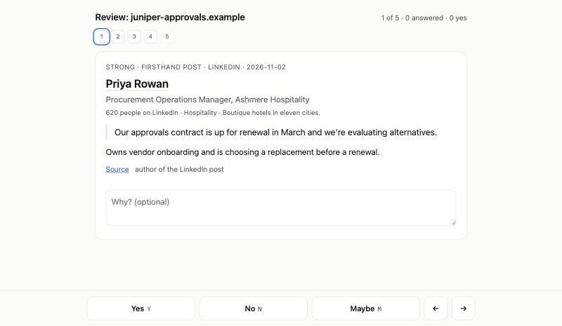

<p align="center">
  
</p>

<h1 align="center">Self-Sourcing Pudding</h1>

<p align="center"><strong>Find the customers who are talking about the problem you solve, right now.</strong></p>

<p align="center">
  <a href="https://github.com/enhance-labs-builds/self-sourcing-pudding/actions/workflows/ci.yml"></a>
  
  
  <a href="LICENSE"></a>
</p>

Pudding finds people describing the problem you solve at their own company. Paste one prompt with your company URL into your coding agent. It reads LinkedIn, X and job ads, and gives you each person's name, role and company, and the post where they said it.

- **Best leads first.** The list is ranked. The clearest evidence, the accounts you want most, senior people and anyone choosing a tool now sit at the top.
- **Only recent posts.** Every post is from the last 30 days. On our latest run, nearly half were from the past week.
- **Ready for your outreach tool.** The list is a CSV that loads straight into the tool you send from. We load ours into HeyReach.
- **On a schedule.** Run it weekly or daily. Each run brings only people you haven't seen.
- **Checked.** Pudding confirms each person's current role and rejects any quote that isn't in the original post.

It fits when your buyers post on LinkedIn or X, in English, about their own work.

Pudding is free and runs on your computer. A run buys under US$1 of lookups from [Treg](https://treg.to), a pay-per-call marketplace for data, which starts new teams with US$1 of free credit. Pudding never signs in to your LinkedIn or X, and it contacts nobody.

**We make a review tool for coding agents. On our own market, one run found [72 people worth contacting in 23 minutes, for US$0.81 of lookups](#results).**

Each row looks like this. These come from the [sample shortlist](examples/shortlist.md) and its [CSV](examples/shortlist.csv), which use invented people:

| Fit | Person | Current role | Evidence |
| --- | --- | --- | --- |
| strong | Priya Rowan | Procurement Operations Manager, Ashmere Hospitality | “Our approvals contract is up for renewal in March and we're evaluating alternatives.” |
| worth a look · hiring signal | Idris Vale | Head of Procurement, Hollis Bay Health | “You will choose and roll out our first purchase-approvals system” |

A hiring signal is a job ad that shows a team has the problem. The row names whoever owns that work today.

## Quick start

You need:

- **A Mac or Linux computer with a coding agent**, such as Claude Code, Codex or Cursor. Desktop apps work. A chat window alone can't run commands.
- **A new, empty folder called `pudding`**, opened as your agent's working folder. Your agent will read posts written by strangers, and the empty folder keeps your other files out of reach.
- **A [Treg](https://treg.to) account.** Treg sells Pudding its lookups. Your agent sets it up with you: you sign in through your browser and copy no keys.
- **About US$1 and half an hour.**

Replace the part in angle brackets and paste this into your agent:

```text
Clone https://github.com/enhance-labs-builds/self-sourcing-pudding (skip this if I already have it) and check I have Python 3.11 or later. Help me set up Treg. Then follow `docs/playbook.md` to find leads for `<my company URL>`. Keep each run in its own dated folder under `~/pudding-runs` and stay under US$1. When it's done, give me the CSV and the review page, and tell me the funnel and the spend.
```

If your site leaves the buyer unclear, name them in one more sentence: "Our buyer is the head of finance at a 50 to 500 person company who still approves purchases by email." To choose who comes first, say which accounts matter most: "Put hospital groups and companies over 1,000 people first."

Keep your agent set to ask before each command. You will approve four things in order: the download, a Python check, the Treg install and sign-in, and commands starting `python3 pudding.py`. Stop and ask why if it requests anything else.

After 20 to 30 minutes your agent gives you `shortlist.csv` and a link to the review page. Filter the CSV to `strong` and `look` and load it into your outreach tool, or press **Y**, **N** or **M** on the page first. Each answer saves into the CSV as you press.



The first run spends its dollar on finding people. To get work email:

```text
Get work email for everyone worth contacting in my latest Pudding run, or only my yes answers if I've reviewed. It costs about US$0.03 a person, so raise that run's cap to cover it.
```

## Runs on a schedule

The best people to write to posted this week. Paste this weekly or daily:

```text
Run Pudding again for `<my company URL>` as a follow-up to my latest run under `~/pudding-runs`, following "Following runs" in `docs/playbook.md`. Stay under US$1. Tell me who is new and where the new CSV is.
```

A follow-up starts from the last run's searches and your answers. It keeps the searches that found people, replaces the ones that didn't, reads everything posted since (at least the past week), and leaves out everyone you've seen. A follow-up we ran the same day as a first run still found 31 new people, 4 of them strong, in 14 minutes for US$0.40.

Claude Code and Codex can run this prompt on a schedule while your computer is on. A scheduled run executes Pudding's commands without asking you, so run it by hand for a few weeks first.

## Cost

| Item | Cost | Detail |
| --- | --- | --- |
| First run | under US$1 | Paid to Treg. Pudding itself is free. Our latest run spent US$0.81. |
| Each follow-up | about US$0.40 | Paid to Treg. |
| Work email | about US$0.03 a person | On top of the run. Thirty people cost about US$1. |
| More job-ad owners | about US$0.03 an ad | Optional, on top of the run. The first run covers the four best ads. |
| Funding rounds | about US$0.01 a company | Optional, on top of the run. Use it when funding tells you which accounts matter. Sixty companies cost about US$0.60. |
| Your agent | 380,000 to 570,000 tokens on Claude Sonnet | Counts against your plan like any other long session. |

Treg is prepaid and starts new teams with US$1 of free credit ([pricing](https://treg.to/pricing)), which covers a first run. Your Treg balance is the outer limit on spend, so keep a few dollars in it and leave automatic top-ups off.

## Guarantees

Pudding's code enforces these. They hold whichever agent runs it.

| Guarantee | How Pudding enforces it |
| --- | --- |
| **Spend stays under the cap** | Pudding reserves each lookup's worst-case cost under a lock before sending it, and tells Treg the most it may charge. It looks up the strongest people first and reports anything the cap left out. A reported charge above the reservation stops the run. |
| **The cap never rises by itself** | Only the `budget` command raises it. Your agent can run that command, so the playbook forbids it unasked and your ask-before-each-command setting lets you refuse it. |
| **Each lookup bills once** | Every lookup carries an idempotency key and a saved receipt, so reruns and crash recovery reuse what you paid for. An unsettled charge blocks new spending until Pudding can account for it. |
| **Quotes are real** | `check` rejects any quote that doesn't appear word for word in the captured post or ad. |
| **Identity is checked** | LinkedIn confirms each person's current role on the day of the run. An X author needs a LinkedIn link on their profile, or two checkable ties to one LinkedIn profile, one of them about the person. Rows your agent placed by name alone say so. |
| **Email addresses are confirmed** | Pudding accepts one address at the employer's own domain, and a second provider must confirm the mailbox. |
| **Your token goes to Treg alone** | Pudding sends it only to `treg.to`, follows no redirects, and stores only a hash. |
| **Run data stays private** | Each run gets its own folder that only your account can read, with a `.gitignore` that excludes everything in it. Delete the folder to remove the data. |
| **Web requests stay on the public internet** | Pudding fetches HTTPS only, refuses private network addresses at connection time, and limits each page to 512 KB and 20 seconds. |
| **Strangers' text stays inert** | Pudding removes terminal escape codes and invisible characters before your agent reads anything, and labels every sheet as data. It neutralises spreadsheet formulas in the CSV and links and HTML in `shortlist.md`. |
| **The review page stays on your computer** | It listens on `127.0.0.1` only, refuses other hostnames and origins, and loads nothing from elsewhere. |

### What leaves your computer

| Recipient | What it receives |
| --- | --- |
| Treg and [its data providers](#treg-and-data-sources) | The searches, names and profile links Pudding looks up. |
| Your agent's model provider | The posts, names and quotes your agent reads. |
| Websites | A request from your computer for your own site, each job ad, and any site linked from an X author's profile. |
| Your LinkedIn and X accounts | Nothing. Pudding never signs in to them. |

### Risks you still own

**Prompt injection.** A stranger's post can contain text written to manipulate an AI. Pudding labels and cleans that text, and no filter can stop a model from being fooled. Three controls limit the damage: start your agent in an empty folder, approve each command yourself, and keep your Treg balance small.

**Outreach.** Pudding reads public posts and contacts nobody. Platform terms and the privacy law where you and your prospects live, such as GDPR, decide whether and how you may write to someone. Read the quote and follow the source link before you do. The reason on each row is your agent's own sentence.

See [SECURITY.md](SECURITY.md) to report a vulnerability.

## Results

We make a review tool for coding agents and pointed Pudding at our own market. One run found 72 people worth contacting in 23 minutes for US$0.81 of lookups: 54 from LinkedIn posts, 14 from X and 4 from job ads. Eleven sit at the accounts we most want, and 26 are graded strong.

A second model then saw each person's role, employer and quote, with no grades. It would message 55 of the 72, including 23 of the 26 strong, and 19 of the first 20 on the list.

| Agent | Worth contacting | Second model would message | Time | Spend |
| --- | --- | --- | --- | --- |
| Claude Sonnet 5.5 | 72 | 55 | 23 minutes | US$0.81 |
| Codex (GPT-6.1 Sol, medium reasoning) | 58 | 40 | 22 minutes | US$0.67 |

Sonnet found more people on our brief and was the more precise, so it is the one we would start with. Each run writes its own searches, so a second run finds people the first one missed.

## How a run works

1. **Plan.** Your agent writes searches in your buyer's words, pairing a tool they use with a phrase like "we switched" or "our renewal".
2. **Read.** It reads up to a thousand authors and keeps people describing their own team's work, dropping advice and sales pitches. It copies the sentence that shows it, and Pudding checks that sentence against the post. When the reading thins out, it writes new searches from what it found and reads again.
3. **Verify.** Pudding confirms who each person is and where they work now. When a post credits a colleague for the work, Pudding adds them beside the person who posted.
4. **Profile the employer.** Pudding records each employer's size, industry and one-line description. Your agent drops direct competitors and labels agencies and large companies.
5. **Read job ads** from LinkedIn, Greenhouse, Ashby, Lever, Workday, SmartRecruiters and Workable. When an ad hands this work to a new hire, Pudding finds whoever owns it today, for the four best ads, and marks the row as a hiring signal.
6. **Rank.** Your agent grades each employer against the accounts that matter most to you, and weighs each person's audience and track record. The best accounts and the people deciding now come first, with colleagues kept together. Ranking removes nobody.
7. **Review.** If you want to cut the list first, you answer yes, no or maybe. Low-fit people, existing customers and anyone Pudding couldn't identify sit in separate sections.
8. **Enrich.** Pudding finds work email for your yes answers, or for everyone worth contacting.

Pudding reads posts from the last 30 days and job ads from the last 90. On our reference run, the typical post was 8 days old and every job ad was under three weeks old.

## Reference

### Output

Each run writes `shortlist.md` and `shortlist.csv` to its folder. Each CSV row holds the person's name, role, company, company size, industry, web domain, location, LinkedIn link and X handle; the quote, its source and date; the search that found them; the run date; their account grade and why, and their reach; and your answer. Rows come best first. The email step adds work email. Filter on `fit` and `your_answer`, and match against your CRM on `profile_url`. For an outreach tool, map `profile_url`, `first_name`, `last_name`, `company` and `work_email`, and bring `quote` and `source_url` as custom fields.

### Suppression lists

Add `--suppress FILE` to the first run to leave out people you already know. The file can be a plain list or a CRM export, and weekly follow-ups keep using it.

| Entry | Leaves out |
| --- | --- |
| LinkedIn profile link | That person |
| Company name or LinkedIn company link | That company |
| Work email or web domain | The company whose website is on that domain |

### Treg and data sources

Pudding buys every lookup through Treg. Behind Treg, HarvestAPI supplies LinkedIn data, AnyAPI and the X API supply X data, Serper and Exa supply web search, AnyAPI and Hunter supply work email, and Aviato supplies funding rounds.

Your agent installs Treg with its own installer (`curl -fsSL https://treg.to/install.sh | sh`) and signs you in with `treg login`. With a Treg team token, set `TREG_TOKEN` and `TREG_ORG` instead. Pudding refuses a team with its own provider keys connected, so every lookup counts against the cap. One read-only X connection is allowed.

### Commands

Your agent runs these from [the playbook](docs/playbook.md).

| Command | Purpose |
| --- | --- |
| `connect` | Check the Treg sign-in. Free. |
| `start URL` | Read the site and create the run folder. Options: `--budget-usd` (default 1.00), `--previous DIR`, `--suppress FILE`, `--window-days N` (default 30). |
| `check` | Validate the plan, the grades and the account grades. |
| `search` | Run the LinkedIn and X searches. |
| `sheet` | Write the next batch of posts to read. `--jobs` for job ads. |
| `searches` | Report what each search found, before searching again. |
| `show ID…` | Print posts or ads in full. |
| `verify` | Confirm identity and current role, and describe the employer. `--low` includes low-fit people. |
| `timeline @handle`, `web "query"` | Help place an X author: their recent posts, and a web search. |
| `spider` | Optional. Read replies under graded posts. |
| `jobs`, `contacts` | Find job ads, then the person who owns the work. `jobs --lookback-days N` (default 90), `contacts --limit N` (default 4). |
| `accounts` | Grade accounts and reach, which set the shortlist's order. `--funding` adds funding rounds. |
| `shortlist` | Write `shortlist.md` and `shortlist.csv`. |
| `review` | Start the review page and print its address. |
| `enrich` | Find work email for your yes answers. `--all` covers everyone worth contacting. |
| `budget USD` | Raise this run's cap. |
| `status` | Show the counts and spend. |

## Development

```sh
python3 -m unittest discover -s tests
```

No dependencies, and the tests never touch the network. Read [CONTRIBUTING.md](CONTRIBUTING.md) before opening a pull request. MIT licence. Built by [Enhance Labs](https://enhancelabs.ai).
